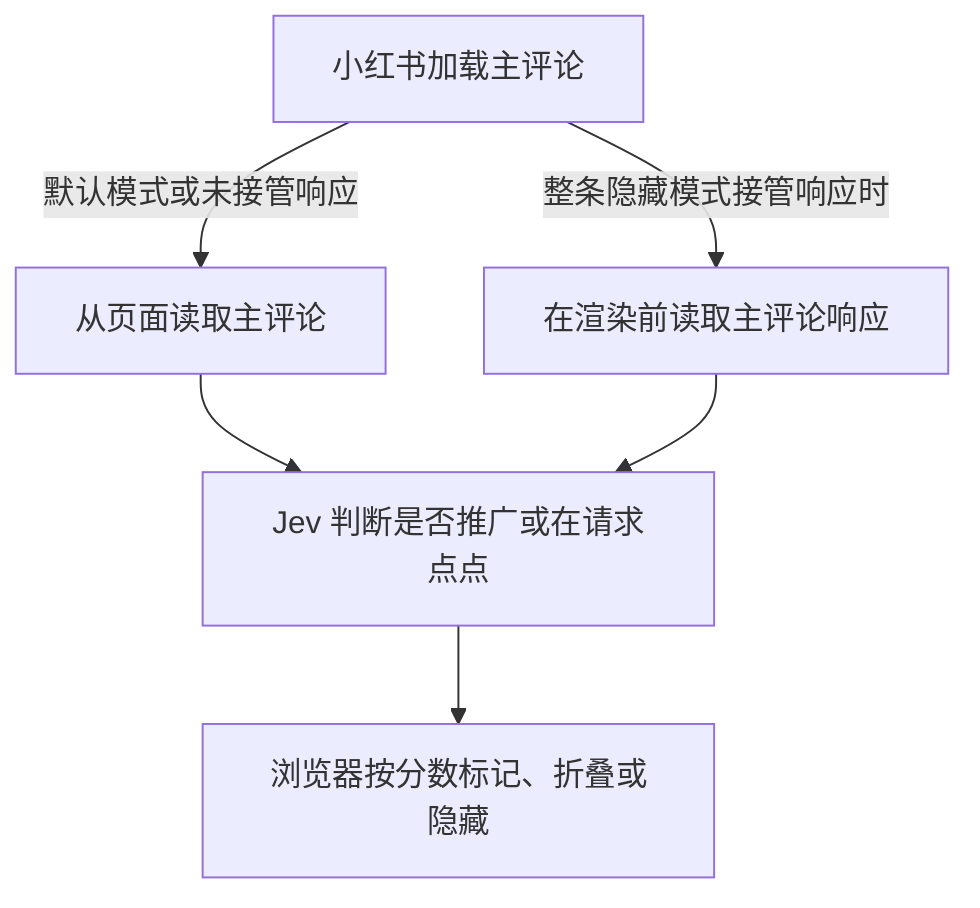

  

<h1 align="center">小红书评论过滤 · Jev</h1>

打开小红书网页版笔记后，自动识别评论里的推广引流和 @点点 请求。高分评论可以折叠，也可以整条隐藏。

  <a href="https://github.com/JDChi/jev-rednote/releases/latest"><strong>下载扩展</strong></a>
  ·
  <a href="#安装与配置">安装与配置</a>
  ·
  <a href="PRIVACY.md">隐私政策</a>

## 效果展示

<strong>左图 · 评论与回复展开时</strong>　｜　<strong>右图 · 整串折叠后</strong>

  
  

## 功能

- **默认折叠。** 高分命中的评论会折叠正文。主评论折叠时会一并收起整串回复，点「展开」即可查看。
- **整条隐藏。** 开启后，扩展会尝试在显示新主评论前完成判断。高分命中的主评论连同整串回复一起隐藏。2 秒内尚未判完的主评论显示原文。
- **疑似标签。** 可疑评论保留原文，并标为「疑似推广」或「疑似点点互动请求」。

## 安装与配置

1. 打开 [最新发布](https://github.com/JDChi/jev-rednote/releases/latest)，在 **Assets** 下载 `jev-rednote-v*.zip`。也可以 [下载 main 源码 ZIP](https://github.com/JDChi/jev-rednote/archive/refs/heads/main.zip)。
2. 解压 ZIP，在 Chrome 打开 `chrome://extensions`，开启「开发者模式」，点「加载已解压的扩展程序」，选择包含 `manifest.json` 的目录。
3. 按 [TypeSafe 快速入门](https://docs.typesafe.ai/introduction/quickstart) 创建 API Key。点击工具栏中的扩展图标，填入 Key，勾选「打开笔记时自动分析评论」并保存。
4. 打开一篇小红书网页版笔记。安装时已经打开的笔记需要刷新一次。向下滚动加载的主评论也会自动分析，楼中楼回复由网页照常显示。

## 工作原理

开启「整条隐藏命中评论」后，扩展会用 Chrome 的调试权限读取小红书网页自己发出的主评论请求的响应。未接管响应时，扩展会从页面读取，并尝试先遮住新插入的主评论，等判定后再显示。判定失败或超时时显示原文。

开启自动分析后，扩展将笔记标题和主评论正文发送给 TypeSafe，批量分析时附带批内编号。API Key 保存在本机的扩展设置中，调用时用于身份验证。分析会计入 TypeSafe API 用量。数据处理与保留方式见 [隐私政策](PRIVACY.md)。
