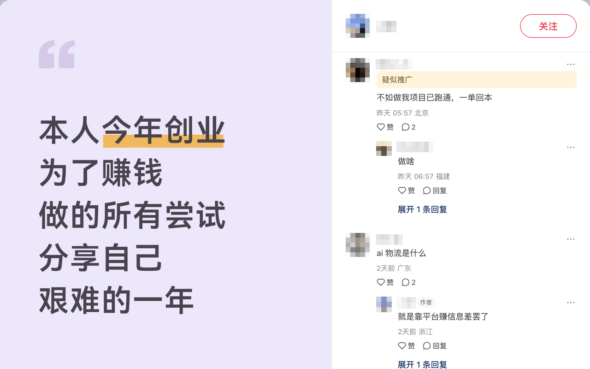
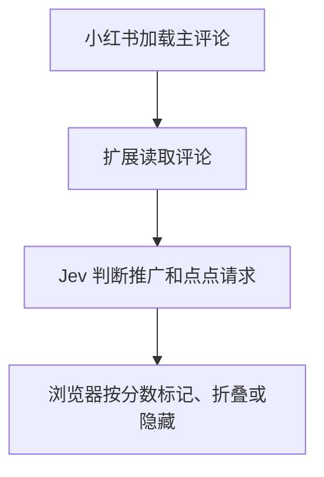

  

<h1 align="center">小红书评论过滤 · Jev</h1>

<strong>刷小红书评论，少看推广引流和 @点点 请求。</strong>

疑似推广会加标签，原文照常读。高分命中的评论和回复可以整串折叠，也可以直接隐藏。

  <a href="https://github.com/JDChi/jev-rednote/releases/latest"><strong>下载 Chrome 扩展</strong></a>
  ·
  <a href="#安装与配置">安装与配置</a>

适用于桌面 Chrome · 需 TypeSafe API Key

## 效果展示

  

疑似推广会标在原文上方，正文和回复照常可读。

<strong>评论与回复展开时</strong>　｜　<strong>整串折叠示例</strong>

  
  

两张图展示不同评论的状态。默认折叠高分命中的主评论和回复，点击「展开」即可查看整串。

想直接跳过整串评论，可以在设置里开启「隐藏整条命中评论」。

## 安装与配置

1. **下载安装包。** 打开 [最新发布](https://github.com/JDChi/jev-rednote/releases/latest)，在 **Assets** 里下载 `jev-rednote-v*.zip` 并解压。
2. **加载扩展。** 在 Chrome 打开 `chrome://extensions`，开启「开发者模式」，点击「加载已解压的扩展程序」，选择包含 `manifest.json` 的目录。
3. **填入 Key 并开启分析。** 按 [TypeSafe 快速入门](https://docs.typesafe.ai/introduction/quickstart) 创建 API Key。点击 Chrome 工具栏里的扩展图标，填入 Key，勾选「打开笔记时自动分析评论」并保存。

打开小红书网页版笔记即可体验。如果笔记已经打开，刷新一次。下滑加载的主评论也会自动分析。

## 数据与隐私

开启自动分析后，扩展会把笔记标题和主评论正文发送给 TypeSafe。API Key 保存在本机的扩展设置中，调用时用于验证身份。分析会计入你的 TypeSafe API 用量。详见 [隐私政策](PRIVACY.md)。

成功判定的分数在本机缓存 7 天。重新打开同一条评论时可以复用分数，省去一次 Jev 分析。卸载扩展会清除缓存。

工作原理

启用评论响应监听时，Chrome 会在小红书标签页显示调试提示。扩展读取网页自己发出的主评论请求的响应，最多额外等待约 2 秒，再把原始响应交给网页。未接管响应时，扩展从页面读取主评论。判定失败或超时时显示原文。

